<p align="center">
  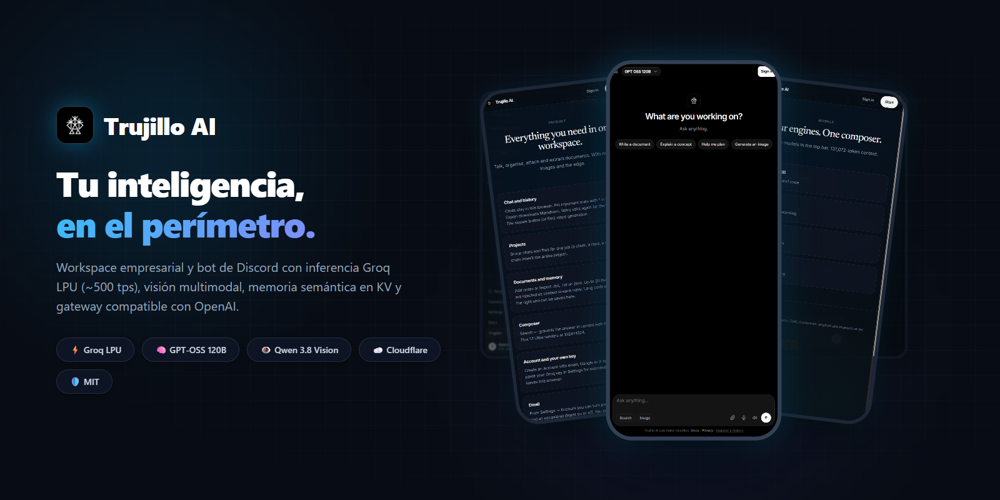
</p>

<p align="center">
  <strong>Workspace de inteligencia empresarial en el perímetro y bot de Discord ultrarrápido con Groq LPU. Minimalista, open source y sin límites.</strong><br/>
  <em>Minimalist, open-source enterprise intelligence workspace &amp; edge Discord bot powered by Cloudflare Workers and Groq LPU inference.</em>
</p>

<p align="center">
  <a href="https://ai.trujillomingorance.com"><b>ai.trujillomingorance.com</b></a> ·
  <a href="https://ai.trujillomingorance.com/models">Modelos</a> ·
  <a href="https://ai.trujillomingorance.com/docs">Documentación</a> ·
  <a href="https://github.com/ATM-Software-Labs/trujillo-ai-studio/releases">Releases</a> ·
  <a href="LICENSE">Licencia MIT</a>
</p>

<p align="center">
  
  
  
  
  
</p>

---

## Capturas

### Escritorio

| Chat Workspace | Cuatro Motores LPU (Modelos) |
|:-:|:-:|
| 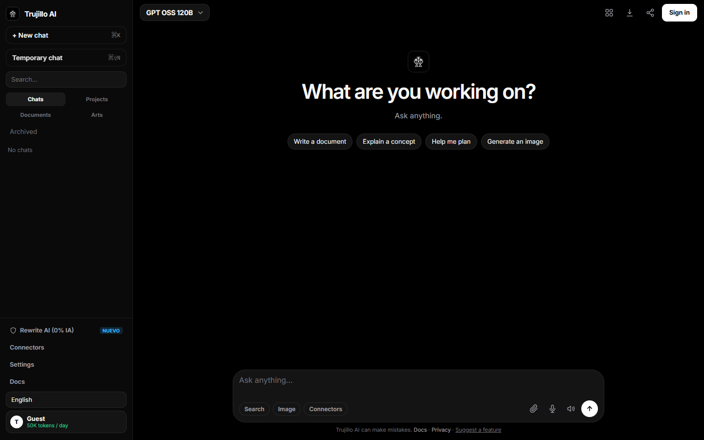 | 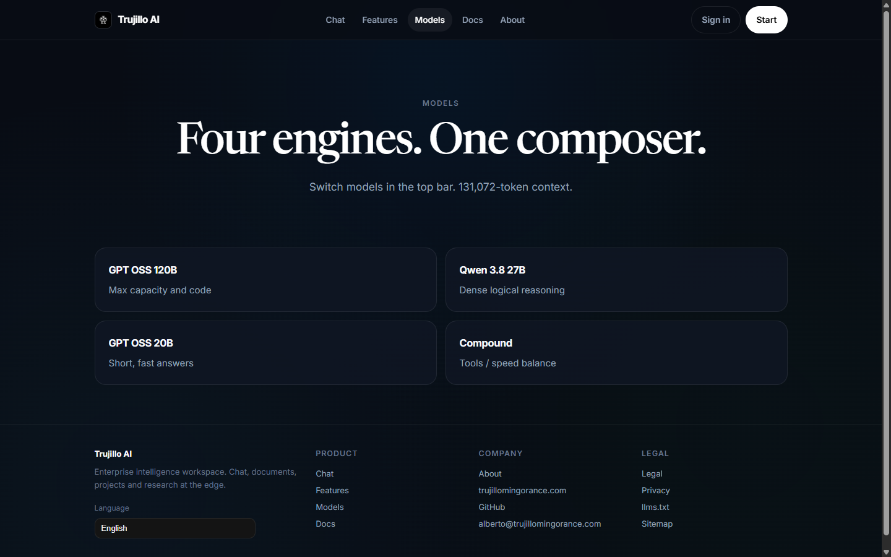 |
| **Capacidades del Producto** | **Inicio de Sesión & OAuth** |
| 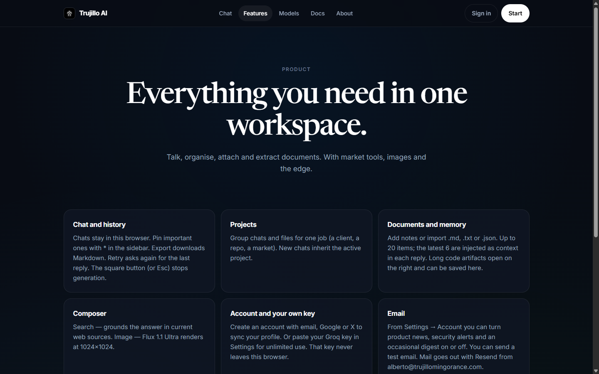 | 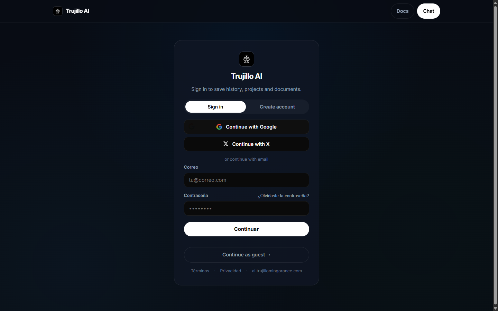 |

### Móvil

| Chat | Modelos | Capacidades | Acceso |
|:-:|:-:|:-:|:-:|
| 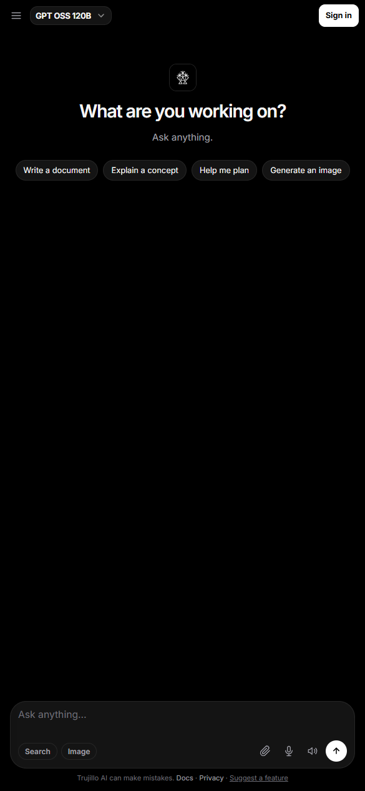 | 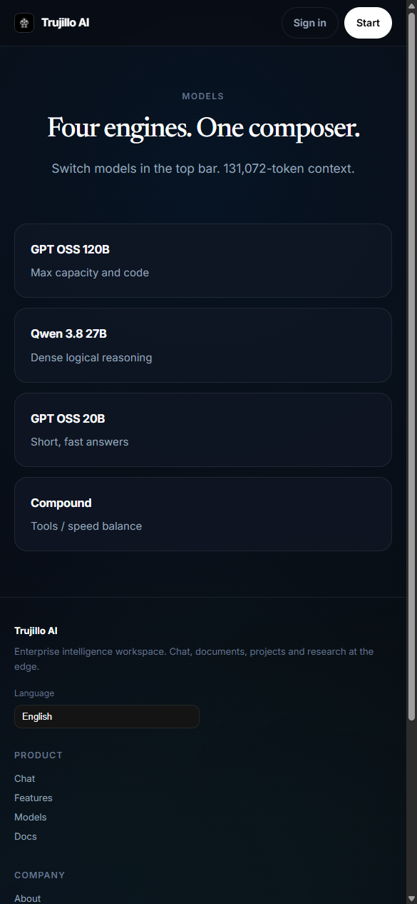 | 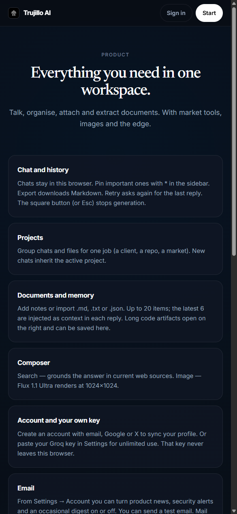 | 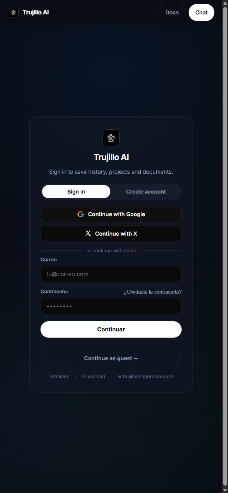 |
| **Documentación** | **Acerca de** | **Términos** | **Privacidad** |
| 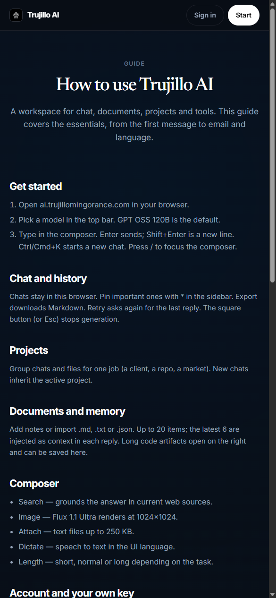 | 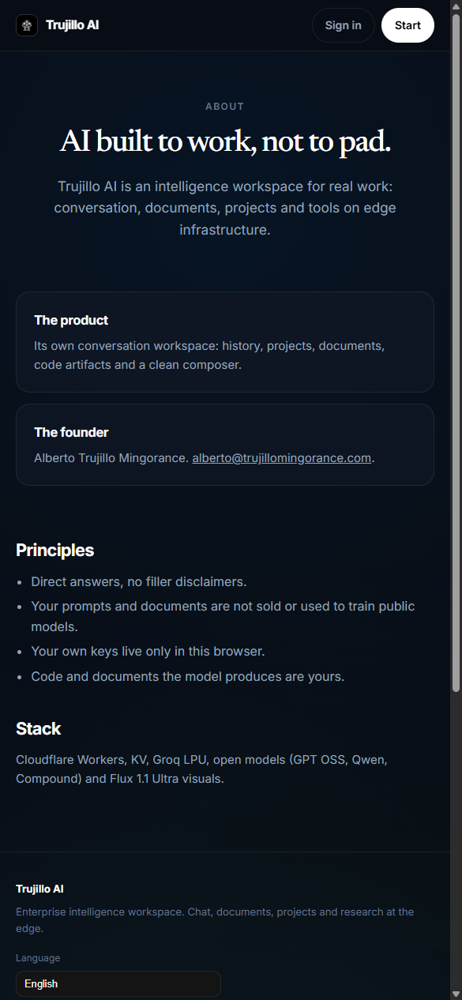 | 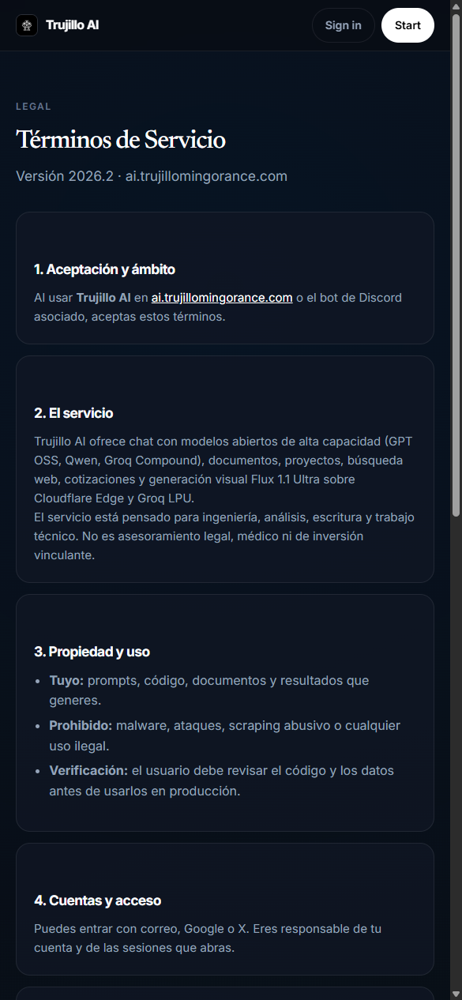 | 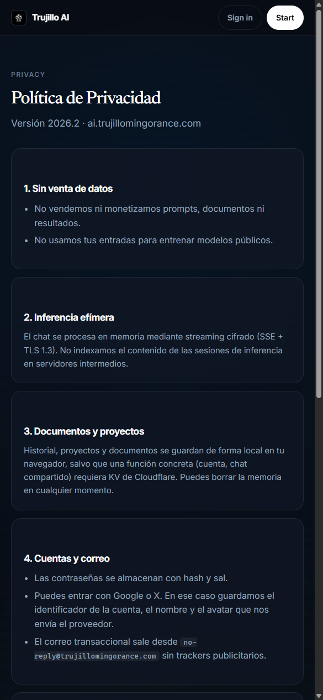 |

---

## Funciones

- **Inferencia en Groq LPU (~500 tokens/segundo):** Streaming ultrarrápido sin colas ni esperas, aprovechando hardware LPU con latencia sub-segundo en respuestas completas.
- **Catálogo de Modelos & Fallback Automático:**
  - `openai/gpt-oss-120b`: Motor insignia de 120B para arquitectura de software, razonamiento profundo y generación de código complejo.
  - `qwen/qwen3.8-27b`: Razonamiento lógico denso y visión multimodal de alta precisión (OCR, diagramas, platos de comida y análisis de documentos).
  - `openai/gpt-oss-20b`: Modelo compacto MoE optimizado para respuestas cortas y latencia mínima.
  - `llama-3.3-70b-versatile` y `llama-3.1-8b-instant`: Escalera de respaldo ante picos de demanda o límites de ratio.
- **Gateway Compatible con OpenAI (`/v1/chat/completions` y `/v1/models`):** Ingesta de visión para aplicaciones externas como [NutriFit](https://github.com/ATM-Software-Labs/nutrifit). Permite consumir inferencia de visión pasando imágenes en Data URL, conservando los prompts del sistema del cliente y limitando el cupo diario en KV con clave secreta opcional `GATEWAY_API_KEY`.
- **Bot de Discord Edge-Native:** Procesamiento de interacciones en el perímetro mediante webhooks HTTP sin procesos WebSocket de fondo. Verificación criptográfica Ed25519, comando slash `/ia` (o `/ai`), selección interactiva de longitud de respuesta, adjuntos y modelos.
- **Memoria Semántica & Perfil Adaptativo:** Extracción automática y asíncrona de notas de contexto del usuario (stack preferido como React/Python, nivel de experiencia, tono y huso horario) almacenadas en Cloudflare Workers KV (`BOT_MEMORY`).
- **Análisis Multimodal de Imagen:** Downscaling optimizado en cliente a 768px y *Context Pruning* automático para evitar sobrecostes de tokens en peticiones con imágenes adjuntas.
- **Transcripción de Voz Instantánea:** Entrada de audio por micrófono o subida de archivo analizada en milisegundos mediante `whisper-large-v3-turbo` en `/api/transcribe`.
- **Búsqueda Web en Tiempo Real:** Enriquecimiento de consultas técnicas con resultados y enlaces en vivo integrados en el flujo de streaming.
- **Generación Visual (Flux 1.1 Ultra):** Creación de imágenes fotorrealistas con optimización de prompt en lenguaje natural asistida por Groq.
- **Bring Your Own Key (BYOK):** Los usuarios pueden introducir su propia clave de Groq en el navegador (almacenada únicamente en su `localStorage`), obteniendo cuota ilimitada sin persistir credenciales en el servidor.
- **Zero-Trust & Seguridad:** Firmado de tokens JWT con HMAC-SHA256 seguro frente a Unicode, autenticación OAuth 2.0 (Google y X/Twitter), protección perimetral contra scrapers maliciosos y cabeceras estrictas (`CSP`, `Referrer-Policy`, `X-Content-Type-Options`).
- **Internacionalización en 26 Idiomas:** Detección automática por IP y geolocalización edge (`cf.country`), con URLs localizadas dedicadas, etiquetas `hreflang` recíprocas y sitemap XML compatible al 100% con Google Search Console.

---

## Stack Tecnológico

| Capa | Tecnología |
|---|---|
| **Runtime & Edge** | **Cloudflare Workers** (ES Modules, ejecución global en 300+ ciudades) |
| **Motor de Inferencia** | **Groq Cloud LPU** (GPT-OSS 120B, Qwen 3.8 27B Vision, Llama 3.3 70B, Whisper Large v3 Turbo) |
| **Base de Datos & Estado** | **Cloudflare Workers KV** (`BOT_MEMORY`) con caché L1 en RAM perimetral |
| **Frontend Web** | Single-Page Application responsiva, temas Obsidian Dark/Navy, streaming SSE, Marked |
| **Bot de Discord** | Discord Interactions API con verificación criptográfica Ed25519 |
| **Gateway de IA** | Endpoints `/v1/chat/completions` y `/v1/models` compatibles con SDKs de OpenAI |
| **Autenticación** | JWT HMAC-SHA256, Google OAuth, X (Twitter) OAuth 2.0 PKCE |
| **SEO & Datos Estructurados** | Schema.org (`SoftwareApplication`, `BreadcrumbList`, `Organization`), Hreflang multilingüe |

---

## Configuración y Despliegue

### Requisitos Previos

- [Node.js](https://nodejs.org/) v20 o superior
- Cuenta en [Cloudflare](https://cloudflare.com/) con Workers y KV habilitados
- Clave de API en [GroqCloud](https://console.groq.com/)

### Instalación Local

```bash
# 1. Clonar el repositorio
git clone https://github.com/ATM-Software-Labs/trujillo-ai-studio.git
cd trujillo-ai-studio

# 2. Instalar dependencias
npm install

# 3. Compilar los assets del cliente web
npm run build:web

# 4. Ejecutar tests unitarios
npm test
```

### Configuración de Secretos en Cloudflare

Inyecta los secretos requeridos en Cloudflare Workers mediante Wrangler:

```bash
# Motor principal de inferencia Groq
npx wrangler secret put GROQ_API_KEY

# Clave de firma para sesiones JWT
npx wrangler secret put JWT_SECRET

# (Opcional) Clave de acceso al Gateway compatible con OpenAI
npx wrangler secret put GATEWAY_API_KEY

# (Opcional) Credenciales de Bot de Discord
npx wrangler secret put DISCORD_PUBLIC_KEY
npx wrangler secret put DISCORD_BOT_TOKEN
```

### Desarrollo y Despliegue a Producción

```bash
# Iniciar entorno de desarrollo local
npm run dev

# Desplegar en producción en Cloudflare Workers
npm run deploy
```

---

## Opciones del Comando de Discord (`/ia`)

| Opción | Tipo | Descripción |
| :--- | :--- | :--- |
| `pregunta` / `prompt` | Texto | Consulta analítica, solicitud de código o tarea de redacción. |
| `modelo` / `model` | Elección | `openai/gpt-oss-120b`, `qwen/qwen3.8-27b`, `openai/gpt-oss-20b`. |
| `longitud` / `length` | Elección | `corto` (resumen conciso), `normal`, `extendido` (análisis exhaustivo). |
| `archivo` / `file` | Adjunto | Imagen para análisis visual, OCR o inspección técnica. |
| `buscar_web` | Booleano | Activa la recuperación de información viva de la web. |

---

## Licencia

Distribuido bajo la [Licencia MIT](LICENSE). Código libre y soberano.
