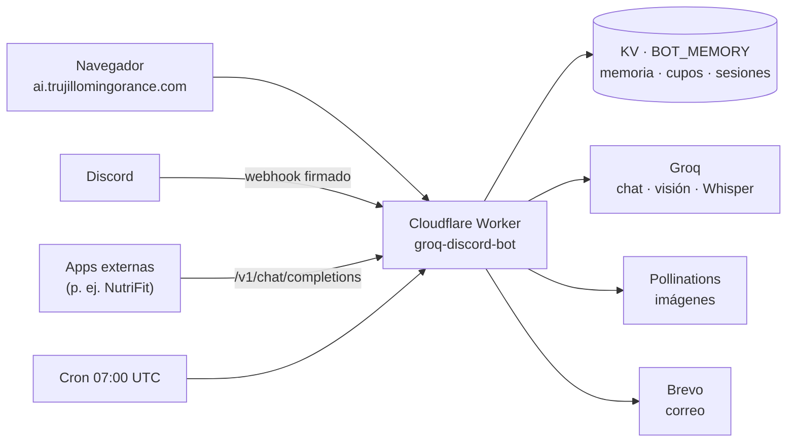

<p align="center">
  
</p>

<p align="center">
  <strong>Chat web con varios modelos de IA, bot de Discord y API compatible con OpenAI, en un único Cloudflare Worker.</strong><br/>
  <em>Multi-model AI chat, Discord bot and OpenAI-compatible API on a single Cloudflare Worker (inference on Groq).</em>
</p>

<p align="center">
  <a href="https://ai.trujillomingorance.com"><b>ai.trujillomingorance.com</b></a> ·
  <a href="CONTRIBUTING.md">Contribuir</a> ·
  <a href="SECURITY.md">Seguridad</a> ·
  <a href="LICENSE">Licencia MIT</a>
</p>

<p align="center">
  
  
  
  
</p>

---

## Capturas

### Escritorio

| Chat | Modelos |
|:-:|:-:|
|  |  |
| **Funciones** | **Acceso** |
|  |  |

### Móvil

| Chat | Modelos | Funciones | Acceso |
|:-:|:-:|:-:|:-:|
|  |  |  |  |

## Funciones

- **Chat en streaming** con varios modelos servidos por Groq: GPT-OSS 120B (por defecto), GPT-OSS 20B y Qwen 3.8 27B (también visión). Si un modelo falla o llega a su límite, se prueba el siguiente.
- **Imágenes:** análisis de fotos con modelos de visión (la imagen se reduce a 768 px en el navegador) y generación de imágenes a partir de texto con Pollinations (modelo Flux).
- **Proyectos:** agrupan chats con nombre, descripción, instrucciones, archivos de texto y rol por defecto; las instrucciones y los archivos se envían como contexto en los chats del proyecto. Se guardan en el navegador (`ta_projects`).
- **Artifacts:** panel lateral con vista previa de HTML/SVG en un marco aislado (`sandbox` sin `allow-same-origin`, CSP estricta), código, Markdown saneado, versiones, copiar y descargar.
- **Voz a texto** con Whisper Large v3 Turbo (`/api/transcribe`).
- **Búsqueda web** opcional para añadir resultados recientes a la respuesta.
- **Memoria por usuario:** notas breves de contexto (preferencias, nivel, zona horaria) guardadas en Workers KV.
- **Clave propia (BYOK):** cada usuario puede poner su clave de Groq; se queda en su navegador.
- **Cuentas:** Google, X (OAuth 2.0 con PKCE) y correo con contraseña. La sesión se comparte con el resto de webs de `*.trujillomingorance.com`.
- **Bot de Discord** por webhooks (sin proceso permanente): comando `/ia` con modelo, longitud, adjunto y búsqueda web. Firma Ed25519 verificada.
- **API compatible con OpenAI:** `POST /v1/chat/completions` y `GET /v1/models`, con clave opcional y cupo diario en KV. La usa, por ejemplo, NutriFit para analizar fotos.
- **Interfaz en muchos idiomas**, incluidos los de derecha a izquierda, con `hreflang` y sitemap.
- **Informe diario** (cron a las 07:00 UTC) con el estado del servicio, y **panel interno** para cuentas de Microsoft Entra ID.

## Stack

| Capa | Tecnología |
|---|---|
| Runtime | **Cloudflare Workers** (módulos ES) con estáticos (`public/`) |
| IA | **Groq** (chat, visión y Whisper) · Pollinations (imágenes) |
| Datos | **Workers KV** (`BOT_MEMORY`, compartido con otras webs del dominio) |
| Frontend | SPA en JavaScript sin framework, streaming SSE y Marked |
| Discord | Interactions API con verificación Ed25519 |
| Email | Brevo (verificación y recuperación de cuenta) |

## Arquitectura



> El Worker también tiene una ruta `*.trujillomingorance.com/*` y hace de proxy para algunos subdominios (Labs, portfolio, FocusGuard) hacia sus proyectos de Pages, y sirve el 404 de los subdominios sin uso.

## Seguridad

- **Sesiones:** JWT HMAC-SHA256 en cookies `HttpOnly; Secure` del dominio. OAuth de X con `state` comprobado y PKCE S256 con verificador aleatorio por inicio de sesión. `/api/auth/logout` solo acepta `POST`.
- **Microsoft Entra ID (admins):** OIDC con `state`, `nonce` y PKCE; se comprueban firma, `iss`, `aud` y `tid` del inquilino. Desactivado hasta que existan los secretos; `MS_LOGIN_DISABLED=1` lo apaga.
- **Discord:** cada interacción se verifica con la clave pública Ed25519 de la aplicación.
- **API OpenAI:** clave Bearer opcional (`GATEWAY_API_KEY`) y cupo diario.
- **Cabeceras:** CSP, `nosniff`, Referrer-Policy y bloqueo de rutas de escáneres (`.env`, `phpinfo`…) con 403.
- Los secretos se cargan con `wrangler secret put`; nunca van en `wrangler.toml`.

## Desarrollo local

Requisitos: **Node.js ≥ 20** y `npx wrangler login`.

```bash
git clone https://github.com/ATM-Software-Labs/trujillo-ai-studio.git && cd trujillo-ai-studio
npm install
npm run build:web      # prepara los estáticos del cliente
npm test               # pruebas de memoria y del panel interno
npm run dev            # wrangler dev
```

| Comando | Qué hace |
|---|---|
| `npm run dev` | Worker en local con Wrangler |
| `npm test` | Pruebas (`scripts/test-*.mjs`) |
| `npm run register` | Registra los comandos de Discord |
| `npm run deploy` | Build + `wrangler deploy` |

## Despliegue

Worker `groq-discord-bot` con dominio propio `ai.trujillomingorance.com` (y `groq.`, `guias.`). Se publica con `npm run deploy`.

### Variables y secretos (solo nombres)

| Nombre | Tipo | Uso |
|---|---|---|
| `BOT_MEMORY` | binding KV | Memoria, cupos y sesiones |
| `ASSETS` | binding de estáticos | Cliente web (`public/`) |
| `GROQ_API_KEY` | secreto | Inferencia en Groq |
| `GROQ_MODEL` | variable | Modelo por defecto |
| `JWT_SECRET` | secreto | Firma de sesión (compartida con las demás webs) |
| `GOOGLE_CLIENT_ID`, `X_CLIENT_ID`, `X_CLIENT_SECRET` | variables / secreto | OAuth |
| `DISCORD_APPLICATION_ID`, `DISCORD_PUBLIC_KEY`, `DISCORD_BOT_TOKEN` | variables / secreto | Bot de Discord |
| `GATEWAY_API_KEY` | secreto, opcional | Clave de la API compatible con OpenAI |
| `BREVO_API_KEY` | secreto | Correos de cuenta |
| `OWNER_EMAIL`, `OWNER_INBOX`, `OWNER_EMAILS` | variables | Destinatarios del informe diario |
| `INFERENCE_BASE_URL`, `INFERENCE_API_KEY`, `INFERENCE_MODEL` | opcionales | Proveedor alternativo compatible con OpenAI |
| `TRUJILLO_AI_SYNC_SECRET` | secreto, opcional | Sincronización con otras webs |
| `MS_CLIENT_ID`, `MS_TENANT_ID`, `MS_CLIENT_SECRET` | secretos, opcionales | Acceso de administradores con Microsoft Entra ID |
| `MS_ALLOWED_DOMAIN`, `ADMIN_EMAILS`, `MS_LOGIN_DISABLED` | variables, opcionales | Dominio permitido, lista de admins e interruptor de apagado |

## Versiones recientes

| Etapa | Commit | Versión de Cloudflare |
|---|---|---|
| Seguridad (CSP, cabeceras, marco aislado, Entra apagado) | `3dec5ce` | `158f47b8-1ba4-41a3-9219-afdf9e449eed` |
| UI | `ad641ba` | `1df56713-d504-4855-860c-9175fe547551` |
| Pulido visual | `03b4e88` | `4f1580d1-8f78-4e3f-8001-4edda3f82b04` |
| Artifacts | `6c4c46c` | `02776a94-06d6-487d-89ea-6ee384a1ccc9` |
| Proyectos | `cec9ea1` | `09748a1d-9b7b-427b-80b4-163f2bc855db` |

## Estructura

```
src/            index.js (rutas), openai_gateway.js, ops.js, langs.js, auth, perfiles, SEO…
public/         estáticos del cliente (assets/, _headers, _routes.json)
web/            cliente alternativo en React (Pages), no es el de producción
scripts/        build de estáticos, registro de comandos de Discord y pruebas
docs/           banner, capturas y documentación
```

## Licencia

[MIT](LICENSE) © 2026 Alberto Trujillo Mingorance.

<p align="center"><sub>© 2026 ATM Software Labs · <a href="https://trujillomingorance.com">trujillomingorance.com</a></sub></p>
